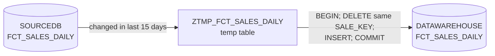

# Airflow 1.x to 3.x DAG Migration

A before-and-after of migrating a daily incremental ETL pipeline from **Apache
Airflow 1.x** to **Airflow 3.x** (the Task SDK), on an MPP warehouse (Netezza).

It is based on a real migration I worked on. Table names, paths and tooling
are made generic; the patterns and the problems found are real.

## The pipeline: `fct_sales_daily`

Every day at 05:30 (Asia/Bangkok) it reloads the last 15 days of new or changed
sales into the warehouse fact table.



| Task | What it does |
|---|---|
| `step1_load_data` | Copies the changed rows into a temp table, distributed like the fact table |
| `step2_update_table` | In one transaction, deletes those sales from the fact table and inserts the new versions; then drops the temp table |

Why delete then insert: a changed sale must replace its old row, not be added
next to it. Re-running the day gives the same result.

## What changed in the migration

| Area | Before (Airflow 1.x) | After (Airflow 3.x) |
|---|---|---|
| DAG import | `from airflow import DAG` | `from airflow.sdk import DAG` |
| Operator import | `airflow.operators.bash_operator` | `airflow.providers.standard.operators.bash` |
| Schedule | `schedule_interval="30 5 * * *"` (server timezone, UTC by default) | `CronDataIntervalTimetable(..., timezone="Asia/Bangkok")` |
| Dependencies | `step2.set_upstream(step1)` | `step1 >> step2` |
| Credentials | Read in the DAG, passed to scripts as arguments | Read by the scripts from `config/db.ini` |
| Alerts | Discord, on every success and failure | Microsoft Teams: failures per task, one success per run |
| Retries | 1 | 2, applied to every task through `default_args` |

## Problems found and fixed

| Problem | Effect | Fix |
|---|---|---|
| `params=default_args` in the first migrated version | Airflow treated the settings as DAG params, so tasks had **0 retries** and no alerts | `default_args=default_args` (checked in Airflow 3.3.2: retries=2 on both tasks) |
| DELETE matched `SALE_KEY IN (...) AND SALE_DATE IN (...)` | When a sale's date was corrected, its old row was not deleted, so the sale appeared **twice** | Delete by `SALE_KEY` only, the unique key of a sale |
| DELETE and INSERT ran as separate statements | A failed INSERT after the DELETE would **lose** those sales | Both inside `BEGIN; ... COMMIT;` |
| Amounts cast to `DOUBLE PRECISION` | Float rounding on money | `NUMERIC(18,2)` |
| Password passed as a command argument from the DAG | Visible in the task command and the process list | Scripts read it from a config file (see the note below) |

Details and examples: [docs/migration_pattern.md](docs/migration_pattern.md).

## Project layout

```
dags/
  original/          Airflow 1.x, as found (paths made generic)
  migrated/          Airflow 3.x
    fct_sales_daily.py
    db_env.sh          shared: reads the connection, defines run_sql
    step1_load_data.sh
    step2_update_table.sh
utils/
  get_db_config.py   reads one connection from config/db.ini
  decode.sh          decodes the base64 password
  teams_notify.py    posts to a Teams webhook (or just logs)
config/
  db.ini.example     copy to db.ini (gitignored)
docs/
  migration_pattern.md
```
